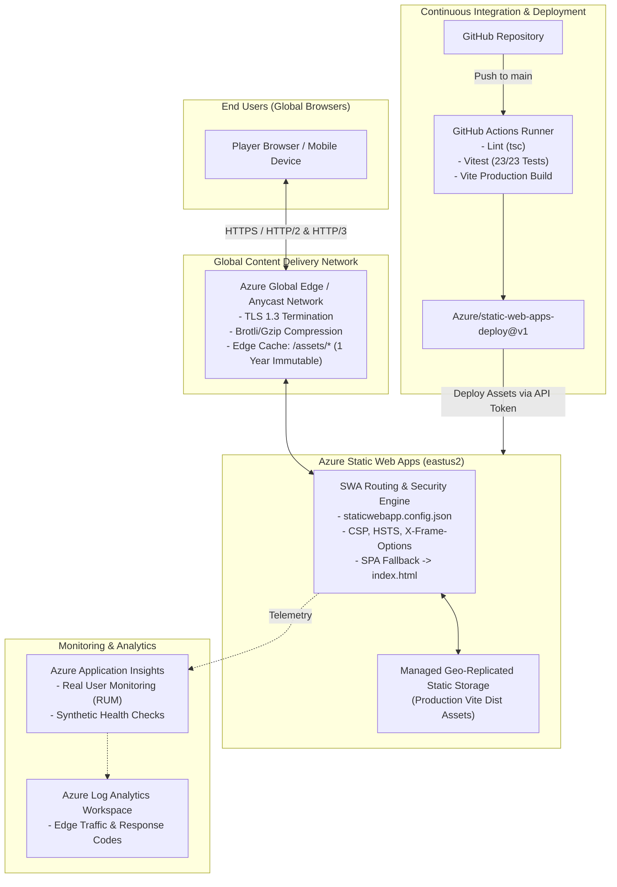

# Azure Hosting & Infrastructure Architecture Design
## PS09 Adaptive Memory Matching Game (Cerevyn)

This document specifies the enterprise hosting architecture, cloud design decisions, infrastructure-as-code (IaC), security posture, and CI/CD deployment model for the **Cerevyn PS09 Adaptive Memory Matching Game** on Microsoft Azure.

---

## 1. Architectural Overview

The application is architected as a high-performance, globally distributed Single Page Application (SPA) utilizing **Azure Static Web Apps (SWA)** fronted by Microsoft's global Anycast edge network with zero compute overhead.



---

## 2. Technology Selection & Hosting Comparison

| Evaluation Metric | Azure Static Web Apps (Selected) | Azure Blob Storage + CDN | Azure App Service (Linux Web App) |
| :--- | :--- | :--- | :--- |
| **Architectural Model** | Serverless Managed Edge Static App | Object Storage + Static Web Endpoint | Docker Container / Node.js Process |
| **Global CDN & Edge** | Built-in Microsoft Global Anycast Edge | Requires manual Azure Front Door/CDN pairing | Requires Azure Front Door addon |
| **Custom Domains & SSL** | Unlimited free auto-renewing managed SSL | Requires Azure Key Vault or CDN SSL | Requires App Service Certificate |
| **CI/CD Integration** | Native GitHub Actions / Azure DevOps workflow | Manual azcopy or storage blob upload task | Web App deployment slot task |
| **Staging Environments** | Automatic preview URLs for Pull Requests | Manual secondary container setup | Deployment slots (Standard tier+) |
| **Monthly Cost** | **\$0.00** (Free Tier) / **\$9.00** (Standard) | ~\$2 - \$5 / month | ~\$13 - \$55 / month |

### Why Azure Static Web Apps is the Optimal Choice:
1. **Zero Cold-Starts & Sub-Millisecond TTFB**: Static assets are pre-rendered by Vite and distributed across global edge points of presence (PoPs).
2. **Built-in Pull Request Previews**: Pull requests generate dedicated ephemeral staging environments for visual acceptance checks.
3. **Turnkey Enterprise Security Headers**: Full control over HTTP response headers (`Content-Security-Policy`, `HSTS`, `X-Content-Type-Options`) via `staticwebapp.config.json`.
4. **Cost-Zero Baseline**: The Free tier comfortably supports high-throughput gameplay without incurring cloud spend.

---

## 3. Infrastructure as Code (Bicep)

The cloud infrastructure is declared in `infra/main.bicep`:

```bicep
@description('Name of the Azure Static Web App resource')
param appName string = 'cerevyn-memory-game'

@description('Azure datacenter location for deployment')
param location string = 'eastus2'

@description('Static Web Apps pricing tier')
@allowed(['Free', 'Standard'])
param skuTier string = 'Free'

resource staticWebApp 'Microsoft.Web/staticSites@2023-01-01' = {
  name: appName
  location: location
  sku: {
    name: skuTier
    tier: skuTier
  }
  properties: {
    repositoryUrl: 'https://github.com/example/cerevyn'
    branch: 'main'
    buildProperties: {
      appLocation: '/'
      outputLocation: 'dist'
      skipGithubActionWorkflowGeneration: true
    }
    stagingEnvironmentPolicy: 'Enabled'
    allowConfigFileUpdates: true
  }
}
```

To deploy via Azure CLI:
```bash
az group create --name rg-cerevyn-prod --location eastus2
az deployment group create --resource-group rg-cerevyn-prod --template-file infra/main.bicep
```

---

## 4. Security & Compliance Baseline

1. **Content Security Policy (CSP)**:
   Configured in `staticwebapp.config.json` to permit only self-hosted scripts, styles, Google Fonts CDN, and local Web Audio generation.
2. **Anti-Clickjacking**:
   `X-Frame-Options: DENY` prevents framing by malicious third-party origins.
3. **MIME Sniffing Protection**:
   `X-Content-Type-Options: nosniff` enforces strict content type adherence.
4. **Anonymous Telemetry Compliance**:
   All game records and session logs are retained in browser-local storage (`localStorage`) using non-PII anonymous tokens (`anon_...`), complying with GDPR/CCPA data minimization.

---

## 5. CI/CD Pipeline Workflow (GitHub Actions)

The deployment pipeline defined in `.github/workflows/ci-cd.yml` automates the release cycle:

1. **Trigger**: Code push or PR merged into `main`.
2. **Quality Gates**:
   - `npx tsc --noEmit` validates strict TypeScript typings.
   - `npm test` executes the 23-test Vitest test suite.
3. **Bundle Compilation**:
   - `npm run build` compiles optimized JavaScript and CSS with gzip/brotli compression.
4. **Deployment**:
   - `Azure/static-web-apps-deploy@v1` transmits artifacts to the Azure Static Web App endpoint.

---

## 6. Cost Estimation & SLA

- **Development / Staging / Production**:
  - **Azure Static Web Apps (Free Tier)**: \$0.00 / month
    - 100 GB global egress bandwidth
    - 2 custom domains with free managed certificates
    - 3 staging environments for PRs
  - **Standard Tier (Optional for enterprise SLA)**: \$9.00 / month
    - 99.95% availability SLA
    - Enterprise private endpoints
